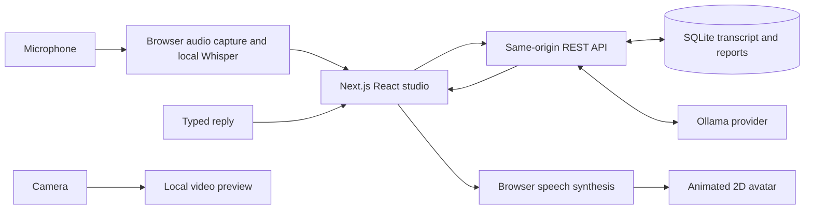

# SpeakMate AI

Ứng dụng luyện hội thoại tiếng Anh B2 chạy trên MacBook. Phiên bản này phục vụ một người học trên máy local.

## Chạy trên macOS

Cần Node.js 22.13+ và [Ollama cho macOS](https://docs.ollama.com/macos). Mở ứng dụng Ollama để bật dịch vụ local, rồi chạy trong thư mục dự án.

```bash
ollama pull qwen2.5:3b
npm ci
npm run dev
```

Để dùng microphone, cài Whisper local một lần. Sau khi cài xong có thể nhận diện tiếng Anh mà không cần dịch vụ nhận diện của Chrome. [whisper.cpp](https://github.com/ggml-org/whisper.cpp#quick-start)

```bash
brew install whisper-cpp
mkdir -p data/models
curl -fL https://huggingface.co/ggerganov/whisper.cpp/resolve/main/ggml-base.en.bin \
  -o data/models/ggml-base.en.bin
```

Mở [http://127.0.0.1:3000](http://127.0.0.1:3000) bằng Chrome. Nếu máy đã có model khác, xem bằng `ollama list` rồi cấu hình, ví dụ `OLLAMA_MODEL=qwen2.5-coder:7b npm run dev`. Có thể sao chép `.env.example` thành `.env.local` để lưu lựa chọn. `OLLAMA_REPORT_MODEL` cho phép chọn model đánh giá riêng. Mặc định báo cáo dùng cùng model với cuộc gọi. Model local không cần API key hoặc chi phí API theo lượt. Tốc độ phụ thuộc model và phần cứng.

1. Chọn nhân vật, chủ đề, chế độ, giọng đọc và tốc độ.
2. Bấm **Start conversation**. Sau câu mở đầu, bấm **Mic** và cấp quyền. Thanh **Mic input** cho biết có tín hiệu. SpeakMate tự chốt lượt sau một khoảng lặng ngắn. Bấm **Done speaking** để chốt ngay khi đang nói. Bấm **Interrupt** để dừng giọng phát và lượt sinh đang chạy, hoặc nhập văn bản bằng ô trả lời.
3. Có thể bật **Camera** để xem hình của mình. **Captions**, **Transcript**, **Replay** và **Pause** dùng ngay trong phiên.
4. Bấm **End call** để xem ngay phiên đã lưu. Báo cáo xuất hiện khi đánh giá hoàn tất. Mở lại phiên từ **History**.

Nếu Ollama gián đoạn, bật lại dịch vụ hoặc cài đúng model rồi chọn **Retry turn**. Transcript đã lưu vẫn đọc được nếu báo cáo gặp lỗi. Báo cáo có thể thử lại từ màn hình kết thúc hoặc History.

## Deploy lên Render

[Mở Blueprint trên Render](https://render.com/deploy?repo=https%3A%2F%2Fgithub.com%2FNamChanIT%2FAPP-H-C-TI-NG-ANH-GIAO-TI-P)

1. Trong Render Dashboard, chọn **New → Blueprint**, kết nối repo GitHub này và chọn nhánh **main**. Render sẽ đọc file `render.yaml`.
2. Nhập `GROQ_API_KEY` cùng `SPEAKMATE_SIGNUP_CODE` trong Dashboard. Tạo key tại [Groq Console](https://console.groq.com/keys) và chọn một mã mời riêng cho nhóm thử. Giữ cả hai giá trị trong Render.
3. Xem mức giá Render hiển thị, chọn **Deploy Blueprint** và mở URL HTTPS Render cấp. Kiểm tra `/api/health`, đăng ký bằng mã mời rồi thử một lượt nói.

Blueprint tạo một Node web service ở Singapore với gói 0,5 CPU / RAM 512 MB và ổ đĩa 1 GB. SQLite được lưu ở `/var/data/speakmate.sqlite`, nên tài khoản và phiên mới còn sau khi redeploy. Dữ liệu local có sẵn trên MacBook nằm trong một database riêng. Giữ một instance cho SQLite và các phiên đang sinh phản hồi.

Khi có `GROQ_API_KEY`, Render dùng Groq cho hội thoại, báo cáo và nhận diện giọng nói. Groq nhận âm thanh của lượt nói và văn bản hội thoại để xử lý, còn camera chỉ chạy trong trình duyệt. Có thể cấu hình `GROQ_CHAT_MODEL` và `GROQ_SPEECH_MODEL` trong Dashboard. Bản local mặc định dùng Ollama và Whisper trên máy.

Render đặt `RENDER_EXTERNAL_URL` tự động. Nếu dùng domain riêng, đặt `SPEAKMATE_PUBLIC_ORIGIN` thành origin HTTPS của domain đó để cookie và kiểm tra origin áp dụng cho đúng địa chỉ.

## Đăng ký và đăng nhập

Mở Studio, chọn **Create account** và nhập email cùng mật khẩu từ 8 ký tự. Email dùng làm định danh local. Sau khi đăng ký, trình duyệt tự đăng nhập. Dùng **Sign out** để thoát tài khoản.

Backend băm mật khẩu bằng scrypt và dùng cookie phiên HttpOnly, SameSite=Strict. Phiên học, báo cáo và thẻ ôn được giới hạn theo tài khoản. Dữ liệu tạo trước khi có tài khoản vẫn nằm trong SQLite dưới hồ sơ local cũ. Tài khoản mới bắt đầu với lịch sử trống. Bản local chưa có xác minh email hoặc đặt lại mật khẩu.

## Ôn từ vựng và câu đã sửa

- Mở **Topic guide** ở Studio để nghe hoặc lưu cụm từ trước khi gọi.
- Trong báo cáo sau phiên, dùng **Listen** để nghe câu sửa và mẫu câu B2. **Save to review** lưu câu sửa hoặc cụm từ có định nghĩa.
- Mở **Review** và tự nhớ đáp án trước khi bấm **Show answer**. **Again** đưa thẻ trở lại sau 10 phút. **Got it** tăng khoảng cách lên 1, 3, 7, 14 và tối đa 30 ngày khi bạn nhớ liên tiếp.

Thẻ và lịch ôn lưu trong SQLite local. Câu sửa lấy từ báo cáo đã lưu và được đọc bằng giọng tổng hợp của trình duyệt.

## Backend chạy riêng

Backend Node.js phục vụ API trên `127.0.0.1:3001`. Sau khi cài Ollama và Whisper theo các bước trên, mở hai terminal trong thư mục dự án.

```bash
# Terminal 1
OLLAMA_MODEL=qwen2.5-coder:7b npm run backend
```

```bash
# Terminal 2
SPEAKMATE_BACKEND_URL=http://127.0.0.1:3001 npm run dev
```

`SPEAKMATE_BACKEND_URL` cũng có thể đặt trong `.env.local`. Khi có biến này, frontend chuyển tiếp API tới backend cùng luồng NDJSON. Khi biến trống, chế độ Next.js tích hợp vẫn dùng được. Dữ liệu dùng cùng file SQLite theo cấu hình `SPEAKMATE_DB`. Giữ một backend xử lý phiên để thao tác **Interrupt** được chuyển tới đúng tiến trình.

| Endpoint | Phương thức | Chức năng |
| --- | --- | --- |
| `/api/health` | GET | Kiểm tra HTTP server |
| `/api/warm` | POST | Nạp sẵn model Ollama |
| `/api/transcribe` | POST | Nhận dạng WAV PCM 16-bit mono 16 kHz bằng Whisper |
| `/api/sessions` | GET, POST | Xem lịch sử hoặc tạo phiên |
| `/api/sessions/:id` | GET | Đọc transcript và báo cáo |
| `/api/sessions/:id/turn` | POST | Hội thoại, hỗ trợ `Accept: application/x-ndjson` |
| `/api/sessions/:id/interrupt` | POST | Dừng một lượt đang sinh |
| `/api/sessions/:id/finish` | POST | Đóng phiên và giữ transcript |
| `/api/sessions/:id/assessment` | POST | Tạo báo cáo bằng Ollama |

```bash
curl -fsS http://127.0.0.1:3001/api/health
```

## Kiến trúc Phase 1



- **Ứng dụng** dùng Next.js App Router, React, JavaScript và CSS đáp ứng. Luồng REST trả NDJSON từng đoạn để hiện phụ đề và đưa câu hoàn chỉnh vào hàng đợi đọc. Trình duyệt phát hiện khoảng lặng, gửi WAV mono tới backend local để Whisper nhận diện. Việc lưu phiên và đánh giá dùng hai yêu cầu riêng.
- **AI** dùng adapter trong `lib/ai.mjs`, nhận ngữ cảnh tối đa 18 tin nhắn gần nhất cho hội thoại. Báo cáo lấy tối đa 24 tin nhắn gần nhất và kiểm tra trích dẫn đối chiếu transcript.
- **Dữ liệu** dùng SQLite qua Node.js để tránh phải dựng PostgreSQL cho một người học. Schema và dữ liệu khởi tạo ở `lib/001-schema.sql`, `lib/db.mjs` và `lib/catalog.mjs`. File mặc định ở `data/speakmate.sqlite`. Chưa có đăng nhập. Chỉ chạy server ở loopback.
- **Quyền riêng tư**. Camera chỉ mở khi bấm nút, hình ảnh ở trong trình duyệt. Ứng dụng lưu văn bản transcript và phản hồi đánh giá trong SQLite. Whisper xử lý âm thanh trên máy. Tệp WAV tạm bị xóa sau nhận diện. Giọng đọc theo giọng cài sẵn của trình duyệt/hệ điều hành.

## Độ trễ và chuẩn bị triển khai

Studio gửi yêu cầu làm nóng khi mở ở tab đang hiển thị. Ollama giữ model trong bộ nhớ 10 phút sau lần dùng gần nhất. Nếu cấu hình hai model và RAM không đủ để giữ cả hai, Ollama có thể phải nạp lại model khi chuyển giữa gọi và đánh giá. [Ollama FAQ](https://docs.ollama.com/faq#how-can-i-preload-a-model-into-ollama-to-get-faster-response-times)

Xem số đo trong Chrome DevTools sau một phiên. Đơn vị là mili giây và các mục đo chỉ nằm trong trình duyệt.

```js
performance.getEntriesByType('measure')
  .filter(entry => entry.name.startsWith('speakmate:'))
  .map(({ name, duration }) => ({ name, ms: Math.round(duration) }))
```

`request-to-audio` đo từ lúc gửi lượt tới lúc trình duyệt bắt đầu đọc. Với giọng nói, `speech-end-to-audio` đo từ mẫu âm thanh có tiếng cuối cùng theo bộ phát hiện khoảng lặng. Khi triển khai qua proxy, kiểm tra luồng NDJSON được truyền ngay và đo p50/p95 trên hạ tầng đích.

Trong một lượt Chrome thử với Ollama 7B thật, giọng bắt đầu ở 274 ms so với 819 ms để hoàn thành lượt chào và 1.041 ms so với 1.971 ms ở lượt sau. Đây là thời gian từ yêu cầu tới phát giọng, chưa gồm nhận diện microphone. Trong ba mẫu Ollama đã nạp model, trung vị tới câu đầu là 448 ms với Qwen 2.5 3B và 1.106 ms với Qwen 2.5 Coder 7B. Model 7B dùng được nhiều chi tiết hội thoại hơn trong các mẫu này. Lần nạp nguội mất khoảng 4 giây trên máy thử.

Bản Render dùng HTTPS, cookie Secure và mã mời cho nhóm thử. Trước khi mở đăng ký rộng rãi, cần phương án xác minh và khôi phục tài khoản, cùng kiểm thử microphone và tải trên hạ tầng đích.

## Kiểm thử và nghiệm thu

```bash
npm test
npm run build
```

Các bài test kiểm tra cấu hình chủ đề, adapter Ollama, lọc bằng chứng và vòng đời phiên với SQLite thật. Mô hình được thay bằng hàm kiểm thử trong bộ test tự động.

Kiểm thử Chrome headless với nguồn microphone giả lập phát một tệp giọng nói tiếng Anh đã đi qua AudioWorklet, bộ dò khoảng lặng, Whisper local, Ollama thật và bộ đọc giọng của Chrome. Whisper nhận đúng câu thử, AI trả lời đúng chủ đề và bắt đầu phát giọng sau khoảng 2,5 giây tính từ cuối lời nói. Kiểm thử Phase 1 cũng bao gồm báo cáo có dẫn chứng, camera mô phỏng và mở lại transcript sau khi tải lại trang.

Nếu thanh **Mic input** không di chuyển khi nói, kiểm tra microphone đầu vào trong Chrome và **System Settings → Sound → Input**. Kiểm tra thêm quyền Chrome trong **Privacy & Security → Microphone**. Nếu thanh có tín hiệu và trạng thái chuyển sang **Transcribing**, âm thanh đã tới SpeakMate.

| Giai đoạn | Tiêu chí nghiệm thu |
| --- | --- |
| Phase 1 | Chọn nhân vật và chủ đề, mở một phiên trên localhost, nhận câu trả lời có ngữ cảnh, xem phụ đề, bật/tắt camera, kết thúc phiên và mở lại transcript cùng báo cáo. Kiểm tra thêm microphone và giọng phát trên Chrome với quyền thiết bị thật. |
| Phase 2 | Theo dõi khuôn mặt phía client có đồng ý, lip sync theo âm thanh, chế độ nhập vai/tranh luận có kịch bản sâu và bài phát âm có kết quả từ dịch vụ đánh giá âm học. |
| Phase 3 | Tiến độ theo lịch sử thật, đồ thị, chuỗi ngày học, ôn từ và kế hoạch học thích ứng. |
| Phase 4 | Đăng nhập, triển khai cloud, kiểm thử thiết bị di động và giám sát vận hành. |

Màn hình gọi dùng ảnh chân dung có chuyển động môi theo sự kiện phát giọng. Chuyển động môi ước lượng theo nhịp đọc và mốc từ mà trình duyệt cung cấp. Báo cáo đưa điểm 1–5 có dẫn chứng cho ngữ pháp, từ vựng, mạch lạc và tương tác khi đủ dữ liệu. Độ trôi chảy và phát âm cần phân tích âm học. 50 chủ đề có bộ gợi ý được tạo theo mẫu và tài liệu dùng chung theo nhóm. Các chế độ nhập vai, tranh luận, mô phỏng và thử thách dùng hướng dẫn cho mô hình ở mức cơ bản.
